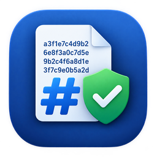
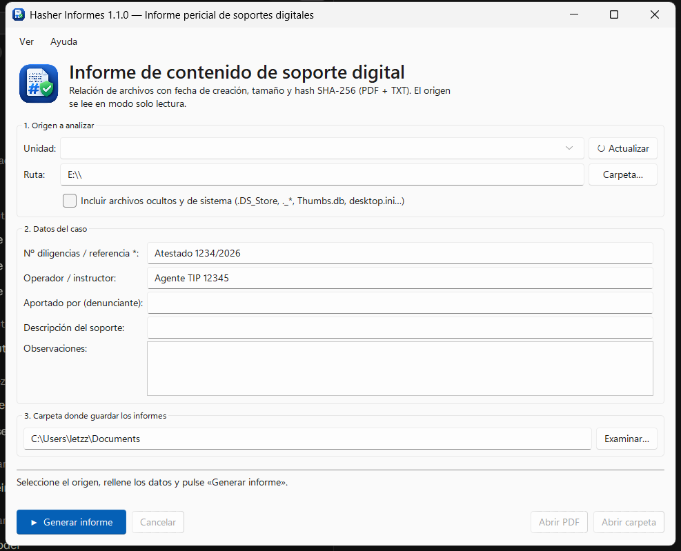
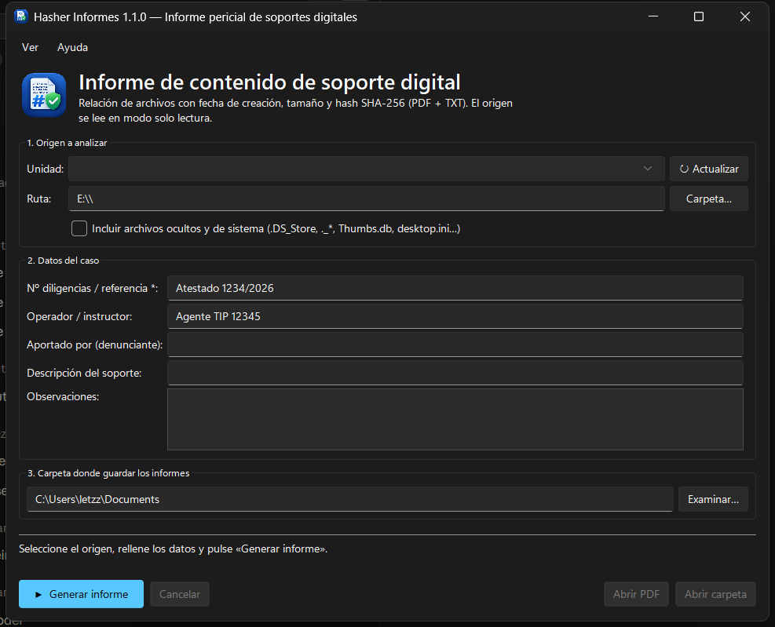

# Hasher Informes



Aplicación de escritorio **portable** que genera un **informe pericial (PDF y TXT)** del contenido de una
carpeta o soporte (pendrive, DVD, disco externo): **nombre, fecha de creación, tamaño y hash SHA-256** de
cada archivo. Sirve para dejar constancia de qué archivos aporta una persona (por ejemplo, un denunciante) y
poder verificar en cualquier momento que no han sido alterados.

*English: portable desktop app that produces a forensic report (PDF + TXT) listing the name, creation date,
size and SHA-256 hash of every file in a folder or removable media. Spanish and English UI.*

| Claro | Oscuro |
|---|---|
|  |  |

## Características

- **Solo lectura**: los archivos del origen nunca se modifican ni se borran.
- Selección de **unidad** (pendrive, DVD…) o **carpeta**.
- Datos del caso: nº de diligencias, operador, aportado por, descripción del soporte y observaciones.
- Casilla para **incluir o excluir archivos ocultos y de sistema** (`.DS_Store`, `._*` de macOS,
  `Thumbs.db`, `desktop.ini`…). Si se excluyen, el informe indica cuántos se han omitido.
- Informe con datos del volumen (etiqueta, nº de serie, sistema de archivos), equipo, usuario, fecha y
  hora, resumen, listado ordenado y el **SHA-256 del TXT** dentro del PDF.
- No permite guardar el informe dentro del soporte analizado.
- Interfaz en **español e inglés** (el informe sale en el idioma elegido) y **modo claro/oscuro**.
- Recuerda el último estado (origen, destino, operador, tema, idioma…). Los datos de cada caso no se
  guardan.

## Descarga

En [Releases](https://github.com/letzzar/hasher-informes/releases) hay un paquete por sistema y arquitectura:

| Sistema | x86-64 | ARM64 |
|---|---|---|
| Windows 10/11 | `…-windows-x64.exe` | `…-windows-arm64.exe` |
| macOS | `…-macos-x64.zip` | `…-macos-arm64.zip` |
| Linux | `…-linux-x64.tar.gz` | `…-linux-arm64.tar.gz` |

No requiere instalación: en Windows es un único `.exe`.

- **macOS**: la app no está firmada por Apple. La primera vez, clic derecho → *Abrir*, o en Terminal:
  `xattr -dr com.apple.quarantine "Hasher Informes.app"`.
- **Linux**: Python no expone la fecha de creación en Linux, por lo que esa columna aparece como `N/D`.

## Uso

1. Elige la unidad o carpeta de origen (y si quieres incluir los archivos ocultos).
2. Rellena los datos del caso (el nº de diligencias es obligatorio).
3. Elige la carpeta donde guardar los informes y pulsa **Generar informe**.

Se generan `Informe_<referencia>_<fecha>.pdf` y `.txt` (`Report_…` en inglés).

La configuración se guarda en:

| Sistema | Ruta |
|---|---|
| Windows | `%APPDATA%\Hasher Informes\settings.json` |
| macOS | `~/Library/Application Support/Hasher Informes/settings.json` |
| Linux | `~/.config/hasher-informes/settings.json` |

## Desarrollo

Requiere Python 3.13.

```bash
python -m venv .venv
.venv\Scripts\activate          # Windows  (macOS/Linux: source .venv/bin/activate)
pip install -r requirements.txt
python main.py
```

- Tests: `python -m unittest discover -s tests -t . -v`
- Ejecutable: `python scripts/build.py --package` (en Windows también `build.bat`) → `dist/`
- Iconos: `python scripts/make_icons.py` regenera `assets/` a partir de `icono.png`.

GitHub Actions compila los seis paquetes en cada push a `main`; al empujar una etiqueta `vX.Y.Z` los
publica como Release (véase [`.github/workflows/build.yml`](.github/workflows/build.yml)).

## Licencia

[GPL-3.0](LICENSE) © 2026 Victor «Letzzar» Gallego.

Usa [ReportLab](https://www.reportlab.com/) (BSD), [sv-ttk](https://github.com/rdbende/Sun-Valley-ttk-theme)
(MIT), [darkdetect](https://github.com/albertosottile/darkdetect) (BSD) y se empaqueta con
[PyInstaller](https://pyinstaller.org/) (GPL con excepción de bootloader).
